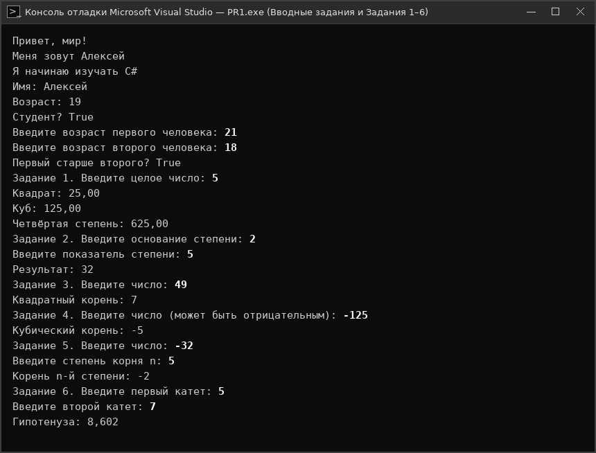
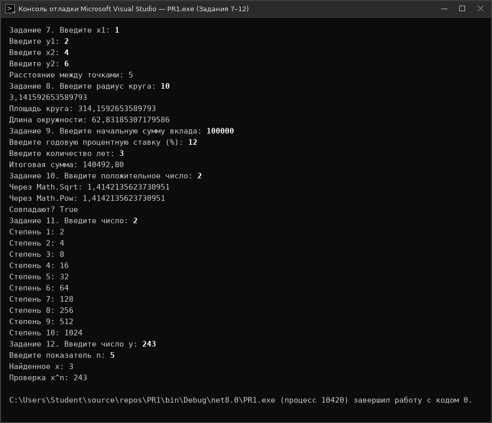

# Отчет по Практической работе №1
## Тема: «Работа с типом данных. Знакомство с языком программирования»

**Учебное заведение:** ГБПОУ г. Москвы «КАИТ № 20»  
**Проверил:** преподаватель Курзанов Н.В.  

---

## Цель и задачи практической работы
- Познакомиться с переменными (`int`, `string`, `bool`).
- Научиться выводить на экран (`Console.WriteLine`).
- Попробовать простые логические сравнения (`>`, `<`, `==`) и математические функции `Math`.

---

## Практическое задание

**Файл кода:** [`Практическая_работа_1.cs`](Практическая_работа_1.cs)

```csharp
using System;

class Program
{
    static void Main()
    {
        // Задание (вводное 1): Вывод трёх строк на экран
        Console.WriteLine("Привет, мир!");
        Console.WriteLine("Меня зовут Алексей");
        Console.WriteLine("Я начинаю изучать C#");

        // Задание (вводное 2): Три переменные с разными типами данных
        int age = 19;
        string name = "Алексей";
        bool isStudent = true;
        Console.WriteLine("Имя: " + name);
        Console.WriteLine("Возраст: " + age);
        Console.WriteLine("Студент? " + isStudent);

        // Задание (вводное 3): Сравнение возраста двух людей
        Console.Write("Введите возраст первого человека: ");
        int age1 = int.Parse(Console.ReadLine());
        Console.Write("Введите возраст второго человека: ");
        int age2 = int.Parse(Console.ReadLine());
        bool isFirstOlder = age1 > age2;
        Console.WriteLine("Первый старше второго? " + isFirstOlder);

        // Задание 1. Возведение в квадрат, куб и четвёртую степень
        Console.Write("Задание 1. Введите целое число: ");
        int a1 = int.Parse(Console.ReadLine());
        Console.WriteLine($"Квадрат: {Math.Pow(a1, 2):F2}");
        Console.WriteLine($"Куб: {Math.Pow(a1, 3):F2}");
        Console.WriteLine($"Четвёртая степень: {Math.Pow(a1, 4):F2}");

        // Задание 2. Возведение числа в степень
        Console.Write("Задание 2. Введите основание степени: ");
        double a2 = double.Parse(Console.ReadLine());
        Console.Write("Введите показатель степени: ");
        double b2 = double.Parse(Console.ReadLine());
        Console.WriteLine("Результат: " + Math.Pow(a2, b2));

        // Задание 3. Квадратный корень с проверкой
        Console.Write("Задание 3. Введите число: ");
        double a3 = double.Parse(Console.ReadLine());
        if (a3 < 0)
        {
            Console.WriteLine("Невозможно вычислить квадратный корень из отрицательного числа.");
        }
        else
        {
            Console.WriteLine("Квадратный корень: " + Math.Sqrt(a3));
        }

        // Задание 4. Кубический корень
        Console.Write("Задание 4. Введите число (может быть отрицательным): ");
        double a4 = double.Parse(Console.ReadLine());
        double res4 = a4 < 0 ? -Math.Pow(-a4, 1.0 / 3.0) : Math.Pow(a4, 1.0 / 3.0);
        Console.WriteLine("Кубический корень: " + res4);

        // Задание 5. Корень n-й степени
        Console.Write("Задание 5. Введите число: ");
        double a5 = double.Parse(Console.ReadLine());
        Console.Write("Введите степень корня n: ");
        int n5 = int.Parse(Console.ReadLine());
        if (a5 < 0 && n5 % 2 == 0)
        {
            Console.WriteLine("Невозможно вычислить корень чётной степени из отрицательного числа.");
        }
        else
        {
            double res5 = a5 < 0 ? -Math.Pow(-a5, 1.0 / n5) : Math.Pow(a5, 1.0 / n5);
            Console.WriteLine("Корень n-й степени: " + res5);
        }

        // Задание 6. Гипотенуза прямоугольного треугольника
        Console.Write("Задание 6. Введите первый катет: ");
        double kat1 = double.Parse(Console.ReadLine());
        Console.Write("Введите второй катет: ");
        double kat2 = double.Parse(Console.ReadLine());
        double gip = Math.Sqrt(kat1 * kat1 + kat2 * kat2);
        Console.WriteLine($"Гипотенуза: {Math.Round(gip, 3)}");

        // Задание 7. Расстояние между двумя точками
        Console.Write("Задание 7. Введите x1: ");
        double x1 = double.Parse(Console.ReadLine());
        Console.Write("Введите y1: ");
        double y1 = double.Parse(Console.ReadLine());
        Console.Write("Введите x2: ");
        double x2 = double.Parse(Console.ReadLine());
        Console.Write("Введите y2: ");
        double y2 = double.Parse(Console.ReadLine());
        double dist = Math.Sqrt(Math.Pow(x2 - x1, 2) + Math.Pow(y2 - y1, 2));
        Console.WriteLine("Расстояние между точками: " + dist);

        // Задание 8. Площадь круга и длина окружности
        Console.Write("Задание 8. Введите радиус круга: ");
        double r = double.Parse(Console.ReadLine());
        Console.WriteLine(Math.PI);
        Console.WriteLine("Площадь круга: " + (Math.PI * r * r));
        Console.WriteLine("Длина окружности: " + (2 * Math.PI * r));

        // Задание 9. Сложный процент
        Console.Write("Задание 9. Введите начальную сумму вклада: ");
        double sum = double.Parse(Console.ReadLine());
        Console.Write("Введите годовую процентную ставку (%): ");
        double percent = double.Parse(Console.ReadLine());
        Console.Write("Введите количество лет: ");
        int years = int.Parse(Console.ReadLine());
        double total = sum * Math.Pow(1 + percent / 100, years);
        Console.WriteLine($"Итоговая сумма: {total:F2}");

        // Задание 10. Сравнение Math.Sqrt() и Math.Pow(число, 0.5)
        Console.Write("Задание 10. Введите положительное число: ");
        double a10 = double.Parse(Console.ReadLine());
        double r1 = Math.Sqrt(a10);
        double r2 = Math.Pow(a10, 0.5);
        Console.WriteLine("Через Math.Sqrt: " + r1);
        Console.WriteLine("Через Math.Pow: " + r2);
        Console.WriteLine("Совпадают? " + (r1 == r2));

        // Задание 11. Таблица степеней от 1 до 10
        Console.Write("Задание 11. Введите число: ");
        double a11 = double.Parse(Console.ReadLine());
        for (int i = 1; i <= 10; i++)
        {
            Console.WriteLine($"Степень {i}: {Math.Pow(a11, i)}");
        }

        // Задание 12. Нахождение x из уравнения x^n = y
        Console.Write("Задание 12. Введите число y: ");
        double y12 = double.Parse(Console.ReadLine());
        Console.Write("Введите показатель n: ");
        int n12 = int.Parse(Console.ReadLine());
        double x12 = Math.Pow(y12, 1.0 / n12);
        Console.WriteLine("Найденное x: " + x12);
        Console.WriteLine("Проверка x^n: " + Math.Pow(x12, n12));
    }
}
```

### Скриншоты работы программы:





---

## Вывод
В ходе выполнения практической работы №1 были изучены основные типы данных C#, операции ввода-вывода, логические сравнения и математические функции `Math`.
