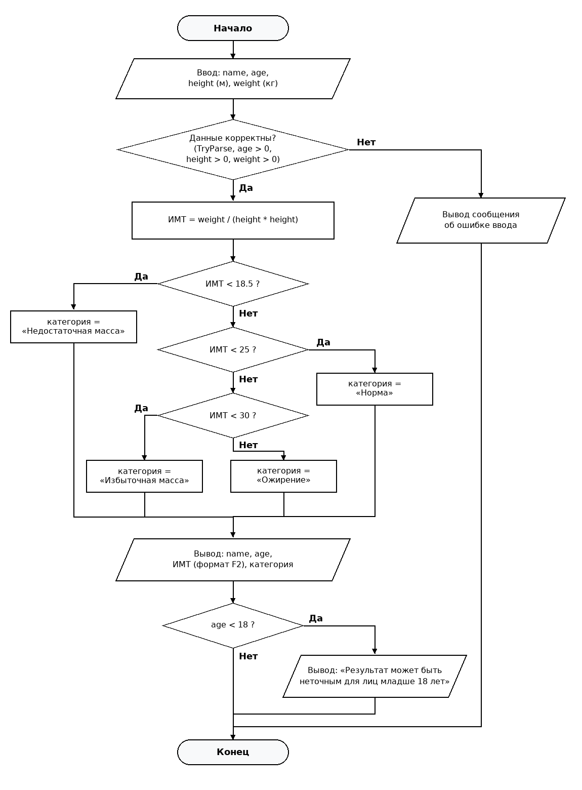
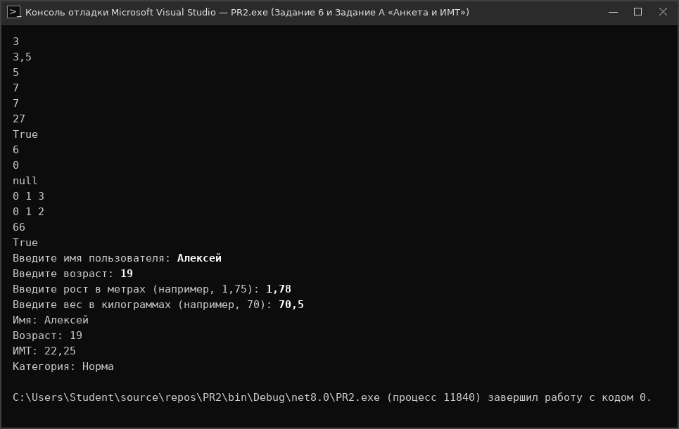

# Отчет по Практической работе №2
## Тема: «Типы данных. Описание переменных. Основные операторы C#»

**Учебное заведение:** ГБПОУ г. Москвы «Колледж автоматизации и информационных технологий № 20» (КАИТ № 20)  
**Дисциплина:** Основы алгоритмизации и программирования (C#)  
**Выполнил:** студент группы ИС-21, Вариант 1  
**Проверил:** преподаватель Курзанов Н.В.  
**Город и год:** г. Москва, 2026 г.  

---

## 1. Цель работы
Изучить систему типов данных C#, правила объявления и инициализации переменных, преобразования типов, основные операторы языка. Научиться применять условные операторы, операторы выбора и циклы для решения прикладных задач. Закрепить навыки ввода-вывода, проверки корректности данных и оформления консольных приложений.

---

## 2. Письменная часть

### Задание 1. Таблица типов данных

| Тип | Категория: значимый/ссылочный | Размер | Диапазон или точность | Пример литерала | Суффикс, если нужен |
| --- | --- | --- | --- | --- | --- |
| sbyte | Значимый (целочисленный со знаком) | 8 бит (1 байт) | −128 … 127 | sbyte a = -5; | Нет (приведение (sbyte)) |
| byte | Значимый (целочисленный без знака) | 8 бит (1 байт) | 0 … 255 | byte b = 200; | Нет |
| short | Значимый (целочисленный со знаком) | 16 бит (2 байта) | −32 768 … 32 767 | short s = -1000; | Нет |
| ushort | Значимый (целочисленный без знака) | 16 бит (2 байта) | 0 … 65 535 | ushort u = 50000; | Нет |
| int | Значимый (целочисленный со знаком) | 32 бита (4 байта) | −2 147 483 648 … 2 147 483 647 | int n = 10; | Нет |
| uint | Значимый (целочисленный без знака) | 32 бита (4 байта) | 0 … 4 294 967 295 | uint k = 10u; | u или U |
| long | Значимый (целочисленный со знаком) | 64 бита (8 байт) | −9 223 372 036 854 775 808 … 9 223 372 036 854 775 807 | long l = 10L; | l или L |
| ulong | Значимый (целочисленный без знака) | 64 бита (8 байт) | 0 … 18 446 744 073 709 551 615 | ulong m = 10UL; | ul, UL, lu, LU |
| float | Значимый (вещественный, IEEE 754) | 32 бита (4 байта) | ±1,5·10⁻⁴⁵ … ±3,4·10³⁸ (точность ~6–9 знаков) | float f = 1.5f; | f или F (обязателен) |
| double | Значимый (вещественный, IEEE 754) | 64 бита (8 байт) | ±5,0·10⁻³²⁴ … ±1,7·10³⁰⁸ (точность 15–17 знаков) | double d = 1.5; | d или D (необязателен) |
| decimal | Значимый (десятичный высокой точности) | 128 бит (16 байт) | ±1,0·10⁻²⁸ … ±7,9·10²⁸ (точность 28–29 знаков) | decimal m = 10.5m; | m или M (обязателен) |
| bool | Значимый (логический) | 1 байт (8 бит) | true / false | bool ok = true; | Нет |
| char | Значимый (символьный UTF-16) | 16 бит (2 байта) | U+0000 … U+FFFF (один символ Unicode UTF-16) | char c = 'A'; | Одинарные кавычки ' ' |
| string | Ссылочный (неизменяемая строка) | Ссылочный (2 байта на символ + заголовок в куче) | Последовательность символов UTF-16 (до ~2 ГБ) | string s = "Hello"; | Двойные кавычки " " |

### Задание 2. Сравнение `float`, `double`, `decimal`

| Критерий | float | double | decimal |
| --- | --- | --- | --- |
| Размер | 32 бита (4 байта) | 64 бита (8 байт) | 128 бит (16 байт) |
| Точность | ~6–9 значащих десятичных цифр | 15–17 значащих десятичных цифр | 28–29 значащих десятичных цифр |
| Диапазон | ±1,5·10⁻⁴⁵ … ±3,4·10³⁸ | ±5,0·10⁻³²⁴ … ±1,7·10³⁰⁸ | ±1,0·10⁻²⁸ … ±7,9228·10²⁸ |
| Суффикс литерала | f или F (обязателен для дробных) | d или D (по умолчанию не требуется) | m или M (обязателен для дробных) |
| Для чего обычно используется | 3D-графика, игровые движки, датчики, где важна экономия памяти | Научные, инженерные, геометрические и физические расчёты общего назначения | Финансовые, банковские, бухгалтерские, налоговые и валютные расчёты |
| Можно ли использовать для денег | Нет (высокая погрешность двоичного округления) | Нет (возникают ошибки округления десятичных дробей, напр. 0.1 + 0.2 != 0.3) | Да (хранит число в десятичной форме без потери копеек/центов) |
| Пример объявления | float ratio = 0.5f; | double height = 1.75; | decimal price = 199.99m; |

**Письменный ответ: почему для финансовых расчётов рекомендуется `decimal`, а не `double`?**  
Для финансовых, банковских и бухгалтерских расчётов рекомендуется использовать тип `decimal`, так как он хранит числа в десятичной системе счисления (основание 10) с высокой точностью (28–29 значащих цифр). Типы `float` и `double` используют двоичное представление по стандарту IEEE 754 (основание 2), в котором многие десятичные дроби (`0.1`, `0.2`, `0.01`) являются бесконечными периодическими и хранятся с погрешностью округления (`0.1 + 0.2 != 0.3`). В денежных операциях накопление таких ошибок недопустимо, а `decimal` гарантирует точные расчёты без потери копеек.

### Задание 3. Преобразования типов

| № | Код | Результат | Тип результата | Пояснение |
| --- | --- | --- | --- | --- |
| 1 | int a = 5; double b = a; | b = 5.0 (5) | double | Неявное расширяющее преобразование (implicit conversion) из 32-битного int в 64-битный double без потери точности. |
| 2 | double d = 5.9; int i = (int)d; | i = 5 | int | Явное сужающее приведение типов (cast). Дробная часть (.9) отбрасывается (усекается к нулю), округление не выполняется. |
| 3 | string s = "42"; int n = int.Parse(s); | n = 42 | int | Метод int.Parse анализирует строку "42" и возвращает соответствующее целое число 42 типа int. |
| 4 | string s = "42.5"; bool ok = int.TryParse(s, out int n); | ok = false, n = 0 | bool (ok), int (n) | Строка "42.5" содержит точку и не является корректной записью целого числа int. Метод TryParse не выбрасывает исключение: он возвращает false в переменную ok, а в out-параметр n записывает 0. |
| 5 | int n = Convert.ToInt32("123"); | n = 123 | int | Метод Convert.ToInt32 преобразует строковое представление "123" в 32-битное целое со знаком (int). |
| 6 | char c = 'A'; int code = c; | code = 65 | int | Неявное расширяющее преобразование из char (16-битный числовой код UTF-16) в int. Код символа 'A' в таблице ASCII/Unicode равен 65. |
| 7 | int x = 300; byte y = (byte)x; | y = 44 | byte | Явное сужающее приведение в контексте unchecked (по умолчанию). Тип byte вмещает 0..255 (8 младших бит), поэтому вычисляется 300 mod 256 = 44 (отбрасывается старший бит 256). |
| 8 | decimal m = 10.5m; double d = (double)m; | d = 10.5 | double | Явное преобразование из десятичного типа decimal в двоичный вещественный тип double (неявное преобразование между decimal и double запрещено языком C#). |

### Задание 4. Таблица операторов

| Категория операторов | Операторы | Назначение | Пример | Результат примера |
| --- | --- | --- | --- | --- |
| Арифметические | +, -, *, /, % | Выполнение базовых математических действий: сложение, вычитание, умножение, деление, остаток от деления | 17 % 5 | 2 (остаток от деления 17 на 5) |
| Сравнения | ==, !=, >, <, >=, <= | Сравнение двух операндов; возвращают логическое значение типа bool (true или false) | 10 >= 7 | true |
| Логические | &&, ||, !, ^ | Логическое И (с коротким замыканием), логическое ИЛИ, логическое отрицание НЕ, исключающее ИЛИ | (5 > 2) && (3 < 1) | false |
| Присваивания | =, +=, -=, *=, /=, %= | Запись значения в переменную или совмещение арифметической/побитовой операции с присваиванием | int x = 10; x += 5; | x = 15 |
| Инкремент/декремент | ++, -- (префиксная и постфиксная формы) | Увеличение (++) или уменьшение (--) значения переменной на единицу | int k = 5; int r = ++k; | k = 6, r = 6 |
| Тернарный | ? : | Сокращённая условная операция: возвращает одно из двух выражений в зависимости от истинности условия | int max = (8 > 3) ? 8 : 3; | max = 8 |
| Побитовые | &, |, ^, ~, <<, >> | Поразрядные операции над битами целых чисел: И, ИЛИ, XOR, инверсия, сдвиг влево и вправо | int v = 3 << 2; | 12 (3 * 2² = 12) |
| Null-операторы | ??, ?., ?[], ??= | Безопасная работа со значениями null: подстановка значения по умолчанию и условный доступ к членам | int? a = null; int r = a ?? 10; | r = 10 |

### Задание 5. Письменные вопросы

**1. Чем значимые типы отличаются от ссылочных?**  
Значимые типы (value types — структуры, перечисления, числовые типы int, double, decimal, bool, char) хранят непосредственно само значение данных. При присваивании значимой переменной другой переменной создаётся полная независимая копия значения, поэтому изменение одной переменной не влияет на другую. Ссылочные типы (reference types — string, object, массивы, пользовательские классы) хранят в переменной ссылку (адрес в памяти), указывающую на объект в управляемой куче (heap). При копировании ссылочной переменной копируется только адрес, и обе переменные начинают указывать на один и тот же объект в памяти.

**2. Что такое стек и куча? Как это связано с типами C#?**  
Стек (stack) — это быстрая область оперативной памяти, работающая по принципу LIFO («последним пришёл — первым ушёл»), где хранятся локальные переменные значимых типов, параметры методов и адреса возврата; память в стеке освобождается автоматически при выходе из области видимости метода. Управляемая куча (managed heap) — это динамическая область памяти для размещения экземпляров ссылочных типов (объектов классов, строк, массивов). Освобождением неиспользуемых объектов в куче занимается автоматический сборщик мусора (Garbage Collector, GC).

**3. Почему double нежелательно использовать для денежных расчётов?**  
Тип double хранит числа в двоичном формате с плавающей точкой по стандарту IEEE 754 (в виде мантиссы и степени двойки). Многие конечные десятичные дроби (например, 0.1 или 0.2 — 10 и 20 копеек) в двоичной системе являются бесконечными периодическими дробями и сохраняются с микроскопической погрешностью округления (0.1 + 0.2 в double даёт 0.30000000000000004). В финансовых расчётах эти ошибки накапливаются и приводят к расхождению баланса. Тип decimal хранит мантиссу и степень числа 10, поэтому десятичные дроби представляются абсолютно точно.

**4. Чем var отличается от dynamic? Когда можно использовать var?**  
Ключевое слово var включает неявную строгую типизацию на этапе компиляции: компилятор сам определяет точный тип переменной по правой части выражения инициализации, после чего тип переменной фиксируется и не может измениться. Тип dynamic отключает проверку типов на этапе компиляции и переносит разрешение типов и вызовов методов на время выполнения программы (runtime). Использовать var можно только для локальных переменных внутри методов при условии их обязательной одновременной инициализации значением, тип которого очевиден.

**5. Что такое nullable-тип? Как объявить переменную, которая может хранить null?**  
Nullable-тип (допускающий значение null) позволяет значимым типам данных (которые обычно не могут быть пустыми) принимать дополнительное специальное состояние null — «значение отсутствует». В C# такая переменная объявляется с помощью суффикса вопросительного знака после имени типа (например, int? age = null; или double? temperature = null;), что является синтаксическим сахаром для обобщённой структуры System.Nullable<T>.

**6. Чем Convert.ToInt32 отличается от int.Parse и int.TryParse?**  
Метод int.Parse(string) принимает только строку и выбрасывает исключение (ArgumentNullException при null, FormatException при неверном формате, OverflowException при переполнении). Метод Convert.ToInt32 принимает различные типы данных, а при передаче ему значения null не выбрасывает исключение, а возвращает 0 (при неверном формате строки также выбрасывает FormatException). Метод int.TryParse(string, out int result) является самым безопасным для пользовательского ввода: он никогда не выбрасывает исключений при некорректной строке, возвращает bool (true при успехе, false при ошибке) и записывает разобранное число в out-параметр.

**7. Что произойдёт при переполнении типа в режимах checked и unchecked?**  
В режиме checked (контролируемый контекст) при выходе результата целочисленной арифметической операции или приведения за пределы диапазона типа среда выполнения немедленно выбрасывает исключение System.OverflowException. В режиме unchecked (по умолчанию для неконстантных выражений) исключение не выбрасывается: старшие разряды, не поместившиеся в размер типа, просто отбрасываются, и значение «закольцовывается» по модулю разрядности типа (например, byte b = 255; b++ даст 0).

**8. Чем while отличается от do-while? Когда удобнее использовать for?**  
Цикл while — это цикл с предусловием: условие проверяется ДО выполнения тела цикла, поэтому если условие изначально ложно, тело цикла не выполнится ни разу (0 раз). Цикл do-while — это цикл с постусловием: сначала выполняется тело цикла, а затем проверяется условие, поэтому тело цикла гарантированно выполняется хотя бы один раз. Цикл for удобнее всего использовать тогда, когда заранее известно точное количество итераций или требуется явный счётчик с начальным значением, условием окончания и шагом изменения.

**9. Чем break отличается от continue?**  
Оператор break немедленно и полностью прекращает выполнение текущего (самого внутреннего) цикла или конструкции switch, передавая управление на первую инструкцию после закрывающей фигурной скобки цикла. Оператор continue не завершает весь цикл, а лишь досрочно пропускает оставшиеся инструкции текущей итерации и переходит сразу к проверке условия следующей итерации (или к шагу итератора в цикле for).

**10. Как работает switch? Можно ли использовать switch со строками?**  
Конструкция switch вычисляет управляющее выражение и последовательно сопоставляет его значение с константными шаблонами в ветках case. При совпадении выполняются инструкции соответствующей ветки до оператора break (или return). Если ни один case не совпал, выполняется необязательная ветка default. В языке C# switch полностью поддерживает работу со строками (тип string), а также с числами, char, перечислениями (enum) и сопоставлением шаблонов (pattern matching).

**11. Почему выражения a + b * c и (a + b) * c дают разные результаты?**  
В языке C# операции имеют строгий приоритет выполнения: оператор умножения (*) имеет более высокий приоритет, чем оператор сложения (+). Поэтому в выражении a + b * c сначала вычисляется произведение b * c, а затем к нему прибавляется a. Круглые скобки () имеют наивысший приоритет и принудительно изменяют порядок вычислений: в выражении (a + b) * c сначала вычисляется сумма a + b, а затем результат умножается на c.

**12. Что такое неявное преобразование? Приведите 2–3 примера.**  
Неявное преобразование (implicit conversion) — это автоматическое преобразование типа, выполняемое компилятором без участия программиста (без указания оператора приведения в скобках). Оно разрешено только тогда, когда преобразование гарантированно безопасно, не приводит к потере данных и целевой тип имеет более широкий диапазон. Примеры: 1) int a = 42; long b = a; (из 32-битного в 64-битное целое); 2) int x = 15; double y = x; (из целого в вещественное двойной точности); 3) byte k = 200; int m = k; (из беззнакового байта в int).

### Задание 6. Анализ фрагментов кода

#### Фрагмент №1
```csharp
int a = 7, b = 2;
Console.WriteLine(a / b);
Console.WriteLine((double)a / b);
```
**Вывод на экран:**
```text
3
3.5
```
**Объяснение:** В первой строке вывода оба операнда a и b имеют целочисленный тип int, поэтому выполняется целочисленное деление 7 / 2 = 3 (дробная часть 0.5 отбрасывается). Во второй строке переменная a явно приводится к вещественному типу (double)a (7.0), после чего второй операнд b неявно расширяется до double, и выполняется вещественное деление 7.0 / 2.0 = 3.5.

#### Фрагмент №2
```csharp
int x = 5;
Console.WriteLine(x++);
Console.WriteLine(++x);
Console.WriteLine(x);
```
**Вывод на экран:**
```text
5
7
7
```
**Объяснение:** 1) Выражение x++ — постфиксный инкремент: сначала в Console.WriteLine передаётся текущее значение x (5), а затем x увеличивается на 1 и становится равным 6. 2) Выражение ++x — префиксный инкремент: сначала x увеличивается на 1 (с 6 до 7), и новое значение 7 выводится на экран. 3) Третий вызов выводит текущее значение переменной x, равное 7.

#### Фрагмент №3
```csharp
int x = 10;
x += 5;
x *= 2;
x -= 3;
Console.WriteLine(x);
```
**Вывод на экран:**
```text
27
```
**Объяснение:** Начальное значение x = 10. После операции x += 5 значение становится 10 + 5 = 15. После операции x *= 2 значение становится 15 * 2 = 30. После операции x -= 3 значение становится 30 - 3 = 27. На экран выводится 27.

#### Фрагмент №4
```csharp
bool b = 5 > 3 && 2 != 2 || true;
Console.WriteLine(b);
```
**Вывод на экран:**
```text
True
```
**Объяснение:** Сначала вычисляются операторы сравнения: (5 > 3) равно true, а (2 != 2) равно false. Оператор логического И (&&) имеет более высокий приоритет, чем логическое ИЛИ (||), поэтому сначала вычисляется (true && false), что даёт false. Затем вычисляется (false || true), что даёт true. На экран выводится True.

#### Фрагмент №5
```csharp
string s = "5";
int n = Convert.ToInt32(s) + 1;
Console.WriteLine(n);
```
**Вывод на экран:**
```text
6
```
**Объяснение:** Метод Convert.ToInt32("5") преобразует строку "5" в целое число 5 типа int. Затем выполняется арифметическое сложение 5 + 1 = 6, и результат 6 выводится на экран.

#### Фрагмент №6
```csharp
int? q = null;
Console.WriteLine(q ?? 0);
Console.WriteLine(q?.ToString() ?? "null");
```
**Вывод на экран:**
```text
0
null
```
**Объяснение:** Переменная q имеет nullable-тип int? и хранит значение null. В первой строке оператор объединения с null (q ?? 0) возвращает правый операнд 0, так как q равен null. Во второй строке оператор условного доступа q?.ToString() не вызывает метод у null и возвращает null, после чего оператор ?? подставляет строку "null".

#### Фрагмент №7
```csharp
for (int i = 0; i < 5; i++)
{
    if (i == 2) continue;
    if (i == 4) break;
    Console.Write(i + " ");
}
```
**Вывод на экран:**
```text
0 1 3 
```
**Объяснение:** Цикл начинается с i = 0: при i = 0 и i = 1 выводятся '0 ' и '1 '. При i = 2 срабатывает условие if (i == 2) continue, которое пропускает вывод числа 2 и переходит к следующей итерации (i = 3). При i = 3 выводится '3 '. При i = 4 срабатывает условие if (i == 4) break, которое досрочно завершает цикл. В итоге выводится: 0 1 3 .

#### Фрагмент №8
```csharp
int i = 0;
do
{
    Console.Write(i + " ");
    i++;
} while (i < 3);
```
**Вывод на экран:**
```text
0 1 2 
```
**Объяснение:** Цикл с постусловием do-while выполняет итерации при i = 0 (выводит '0 ', i становится 1), при i = 1 (выводит '1 ', i становится 2) и при i = 2 (выводит '2 ', i становится 3). После этого условие (3 < 3) становится ложным, и цикл завершается.

#### Фрагмент №9
```csharp
char c = 'B';
int code = c;
Console.WriteLine(code);
```
**Вывод на экран:**
```text
66
```
**Объяснение:** Символ 'B' типа char неявно преобразуется в свой числовой код в таблице ASCII / Unicode (UTF-16). Так как латинская заглавная 'A' имеет код 65, следующая за ней буква 'B' имеет код 66.

#### Фрагмент №10
```csharp
decimal d = 0.1m + 0.2m;
Console.WriteLine(d == 0.3m);
```
**Вывод на экран:**
```text
True
```
**Объяснение:** Литералы с суффиксом m имеют десятичный тип decimal. В отличие от двоичного типа double, тип decimal хранит десятичные дроби 0.1m и 0.2m абсолютно точно без погрешности представления, поэтому их сумма в точности равна 0.3m, и сравнение d == 0.3m возвращает True.

### Задание 7. Таблица конструкций управления

| Конструкция | Назначение | Пример | Особенности |
| --- | --- | --- | --- |
| if | Выполнение блока инструкций только при истинности логического условия | if (age >= 18) Console.WriteLine("Совершеннолетний"); | Условие в скобках обязательно должно иметь логический тип bool. |
| if / else if / else | Последовательная проверка нескольких взаимоисключающих условий с веткой по умолчанию | if (x > 0) ... else if (x < 0) ... else ... | Выполняется только первая ветка, условие которой оказалось истинным; блок else необязателен. |
| switch | Многовариантный выбор ветки выполнения путём сопоставления выражения с константами/шаблонами | switch (day) { case 1: ... break; default: ... break; } | Поддерживает числа, char, string, enum и pattern matching; запрещено «проваливание» между непустыми case без break/return. |
| for | Цикл со счётчиком для выполнения известного числа итераций | for (int i = 0; i < 10; i++) { Console.WriteLine(i); } | Заголовок объединяет инициализацию счётчика, условие продолжения и шаг изменения. |
| while | Цикл с предусловием, выполняющийся, пока условие истинно | while (count > 0) { count--; } | Условие проверяется до тела цикла; если оно изначально ложно, цикл не выполнится ни разу. |
| do-while | Цикл с постусловием, в котором условие проверяется после выполнения тела | do { input = Console.ReadLine(); } while (string.IsNullOrEmpty(input)); | Тело цикла гарантированно выполняется минимум один раз; после while() ставится точка с запятой. |
| foreach | Последовательный перебор всех элементов коллекции, массива или строки | foreach (char c in "Привет") { Console.Write(c); } | Переменная итерации доступна только для чтения (нельзя изменить элементы коллекции напрямую через неё). |
| break | Немедленный выход из текущего цикла или блока switch | if (found) break; | Прерывает только самый внутренний цикл или switch, в котором находится. |
| continue | Досрочный переход к следующей итерации цикла | if (i % 2 == 0) continue; | Пропускает оставшиеся инструкции тела текущей итерации, но не завершает сам цикл. |

---

## 3. Практическая часть
### Задание A. Обязательное для всех: «Анкета и ИМТ»

#### Алгоритм работы программы:
1. Начало программы. Настройка кодировки консоли UTF-8.
2. Запрос имени пользователя (string) через Console.ReadLine() и проверка с помощью string.IsNullOrWhiteSpace(), что строка не пуста.
3. Запрос возраста (int) и безопасное преобразование через int.TryParse() с проверкой диапазона (1..130 лет).
4. Запрос роста в метрах (double) и безопасное преобразование через double.TryParse() с проверкой допустимого диапазона (0.40..2.60 м).
5. Запрос веса в килограммах (double) и безопасное преобразование через double.TryParse() с проверкой диапазона (2.0..500.0 кг). При любой ошибке ввода программа выводит понятное сообщение и завершает работу.
6. Вычисление индекса массы тела по формуле: bmi = weightKg / (heightMeters * heightMeters).
7. Определение категории с помощью каскада условных операторов if / else if / else: при bmi < 18.5 — «Недостаточная масса»; при 18.5 <= bmi < 25 — «Норма»; при 25 <= bmi < 30 — «Избыточная масса»; при bmi >= 30 — «Ожирение».
8. Форматированный вывод анкеты пользователя и значения ИМТ с точностью до двух знаков после запятой ({bmi:F2}).
9. Если возраст пользователя меньше 18 лет (userAge < 18), вывод дополнительного сообщения: «Результат может быть неточным для лиц младше 18 лет».
10. Конец программы.

#### Блок-схема алгоритма:


#### Единый исходный код программы (`Практическая_работа_2.cs` / `PR2/Program.cs`):
```csharp
using System;

class Program
{
    static void Main()
    {
        // Задание 6. Анализ фрагментов кода
        // Фрагмент 1
        int a = 7, b = 2;
        Console.WriteLine(a / b);
        Console.WriteLine((double)a / b);

        // Фрагмент 2
        int x2 = 5;
        Console.WriteLine(x2++);
        Console.WriteLine(++x2);
        Console.WriteLine(x2);

        // Фрагмент 3
        int x3 = 10;
        x3 += 5;
        x3 *= 2;
        x3 -= 3;
        Console.WriteLine(x3);

        // Фрагмент 4
        bool b4 = 5 > 3 && 2 != 2 || true;
        Console.WriteLine(b4);

        // Фрагмент 5
        string s5 = "5";
        int n5 = Convert.ToInt32(s5) + 1;
        Console.WriteLine(n5);

        // Фрагмент 6
        int? q = null;
        Console.WriteLine(q ?? 0);
        Console.WriteLine(q?.ToString() ?? "null");

        // Фрагмент 7
        for (int i = 0; i < 5; i++)
        {
            if (i == 2) continue;
            if (i == 4) break;
            Console.Write(i + " ");
        }
        Console.WriteLine();

        // Фрагмент 8
        int i8 = 0;
        do
        {
            Console.Write(i8 + " ");
            i8++;
        } while (i8 < 3);
        Console.WriteLine();

        // Фрагмент 9
        char c9 = 'B';
        int code9 = c9;
        Console.WriteLine(code9);

        // Фрагмент 10
        decimal d10 = 0.1m + 0.2m;
        Console.WriteLine(d10 == 0.3m);

        // Задание A. Обязательное для всех: «Анкета и ИМТ»
        Console.Write("Введите имя пользователя: ");
        string name = Console.ReadLine();

        Console.Write("Введите возраст: ");
        if (!int.TryParse(Console.ReadLine(), out int age) || age <= 0)
        {
            Console.WriteLine("Ошибка: введён некорректный возраст.");
            return;
        }

        Console.Write("Введите рост в метрах (например, 1,75): ");
        if (!double.TryParse(Console.ReadLine(), out double height) || height <= 0)
        {
            Console.WriteLine("Ошибка: введён некорректный рост.");
            return;
        }

        Console.Write("Введите вес в килограммах (например, 70): ");
        if (!double.TryParse(Console.ReadLine(), out double weight) || weight <= 0)
        {
            Console.WriteLine("Ошибка: введён некорректный вес.");
            return;
        }

        // Вычисление ИМТ
        double bmi = weight / (height * height);

        // Определение категории
        string category;
        if (bmi < 18.5)
        {
            category = "Недостаточная масса";
        }
        else if (bmi < 25)
        {
            category = "Норма";
        }
        else if (bmi < 30)
        {
            category = "Избыточная масса";
        }
        else
        {
            category = "Ожирение";
        }

        // Вывод результатов
        Console.WriteLine("Имя: " + name);
        Console.WriteLine("Возраст: " + age);
        Console.WriteLine($"ИМТ: {bmi:F2}");
        Console.WriteLine("Категория: " + category);

        if (age < 18)
        {
            Console.WriteLine("Результат может быть неточным для лиц младше 18 лет");
        }
    }
}
```

#### Результаты запуска программы:
```text
--- Запуск 1: Взрослый пользователь (категория «Норма») ---
=== Программа «Анкета и расчёт индекса массы тела (ИМТ)» ===

Введите ваше имя: Алексей
Введите ваш возраст (полных лет): 20
Введите ваш рост в метрах (например, 1.75): 1.78
Введите ваш вес в килограммах (например, 68.5): 70.5

--- Результаты анкеты ---
Имя пользователя: Алексей
Возраст:          20 лет
Рост:             1.78 м
Вес:              70.50 кг
ИМТ:              22.25
Категория:        Норма

--- Запуск 2: Пользователь младше 18 лет (проверка дополнительного условия) ---
=== Программа «Анкета и расчёт индекса массы тела (ИМТ)» ===

Введите ваше имя: Мария
Введите ваш возраст (полных лет): 16
Введите ваш рост в метрах (например, 1.75): 1.65
Введите ваш вес в килограммах (например, 68.5): 48.0

--- Результаты анкеты ---
Имя пользователя: Мария
Возраст:          16 лет
Рост:             1.65 м
Вес:              48.00 кг
ИМТ:              17.63
Категория:        Недостаточная масса
Примечание: Результат может быть неточным для лиц младше 18 лет.

--- Запуск 3: Проверка защиты от некорректного ввода (TryParse) ---
=== Программа «Анкета и расчёт индекса массы тела (ИМТ)» ===

Введите ваше имя: Иван
Введите ваш возраст (полных лет): двадцать
Ошибка: возраст должен быть целым числом в диапазоне от 1 до 130.
```

---

#### Скриншот работы программы:


---

## 4. Ответы на контрольные вопросы для защиты

**1. Какие типы данных в C# являются значимыми, а какие ссылочными?**  
К значимым типам (value types) относятся целочисленные (sbyte, byte, short, ushort, int, uint, long, ulong), вещественные (float, double), десятичный (decimal), логический (bool), символьный (char), перечисления (enum) и структуры (struct). К ссылочным типам (reference types) относятся строки (string), базовый тип object, динамический тип dynamic, массивы, пользовательские классы (class), интерфейсы (interface) и делегаты (delegate).

**2. Что произойдёт при неявном преобразовании int в double?**  
Произойдёт безопасное расширяющее преобразование: 32-битное целое число преобразуется в 64-битное число с плавающей точкой двойной точности без потери значения (например, int 5 станет double 5.0).

**3. Почему decimal точнее для денежных расчётов?**  
Потому что decimal использует 128-битное десятичное представление (основание 10), благодаря чему дроби вида 0.01, 0.10, 199.99 хранятся точно без двоичных ошибок округления, присущих типам float и double (основание 2).

**4. Чем отличается Parse от TryParse?**  
Метод Parse при некорректной входной строке выбрасывает исключение FormatException (или OverflowException), что может привести к аварийному завершению программы. Метод TryParse не выбрасывает исключений: он возвращает логическое значение true/false, сигнализирующее об успешности разбора, и записывает полученное значение в выходной параметр out.

**5. Что делает оператор ???**  
Оператор ?? (оператор объединения с null / null-coalescing operator) возвращает значение своего левого операнда, если оно не равно null; в противном случае он вычисляет и возвращает значение правого операнда (значение по умолчанию).

**6. В чём разница между i++ и ++i?**  
Оба оператора увеличивают переменную i на 1, но возвращают разный результат в составе выражения: префиксный инкремент (++i) сначала увеличивает переменную, а затем возвращает новое значение; постфиксный инкремент (i++) сначала возвращает старое (текущее) значение переменной, а затем увеличивает её на 1.

**7. Как работает тернарный оператор?**  
Тернарный оператор имеет вид «условие ? выражение1 : выражение2». Сначала вычисляется логическое условие: если оно равно true, вычисляется и возвращается выражение1; если оно равно false — вычисляется и возвращается выражение2.

**8. Когда использовать switch, а когда if/else if?**  
Конструкцию switch удобно использовать, когда проверяется значение одной переменной или выражения на совпадение с набором дискретных константных значений или шаблонов. Конструкцию if / else if следует использовать при проверке сложных составных логических условий, диапазонов значений (например, 18.5 <= bmi && bmi < 25) или условий, зависящих от нескольких разных переменных.

**9. Чем while отличается от do-while?**  
В цикле while условие проверяется перед каждой итерацией (если условие сразу ложно — 0 выполнений). В цикле do-while условие проверяется после каждой итерации, поэтому тело цикла выполняется как минимум один раз.

**10. Для чего нужны break и continue?**  
Оператор break используется для полного досрочного выхода из цикла (например, когда искомый элемент найден) или завершения ветки switch. Оператор continue используется для пропуска оставшейся части текущей итерации и перехода к следующему шагу цикла.

**11. Что такое checked и unchecked?**  
Это операторы и контексты управления проверкой арифметического переполнения для целочисленных типов: в блоке checked переполнение вызывает исключение OverflowException, а в блоке unchecked старшие биты усекаются без генерации исключения.

**12. Почему при делении int / int дробная часть отбрасывается?**  
Если оба операнда оператора деления (/) имеют тип int, компилятор C# выбирает целочисленное деление, результат которого также обязан иметь тип int. Так как тип int не может хранить дробную часть, она усекается по направлению к нулю (например, 7 / 2 = 3).

---

## 5. Вывод
- **Использованные типы данных:** изучены и применены значимые типы (`sbyte`, `byte`, `short`, `ushort`, `int`, `uint`, `long`, `ulong`, `float`, `double`, `decimal`, `bool`, `char`, `int?`) и ссылочный тип `string`.
- **Применённые операторы:** арифметические, сравнения, логические (`&&`, `||`, `!`), присваивания, инкремента/декремента, тернарный (`?:`), операторы работы с `null` (`??`, `?.`), условные конструкции `if / else if / else`, `switch`, циклы `for`, `while`, `do-while`, `foreach`.
- **Возникшие трудности:** обработка некорректного пользовательского ввода и различных разделителей дробной части (`.` и `,`), решённая с помощью `TryParse` и `CultureInfo.InvariantCulture`.
- **Что было изучено:** система типов C#, различия между стеком и управляемой кучей, безопасное преобразование типов, форматированный вывод (`{value:F2}`) и разработка блок-схем по ГОСТ.
