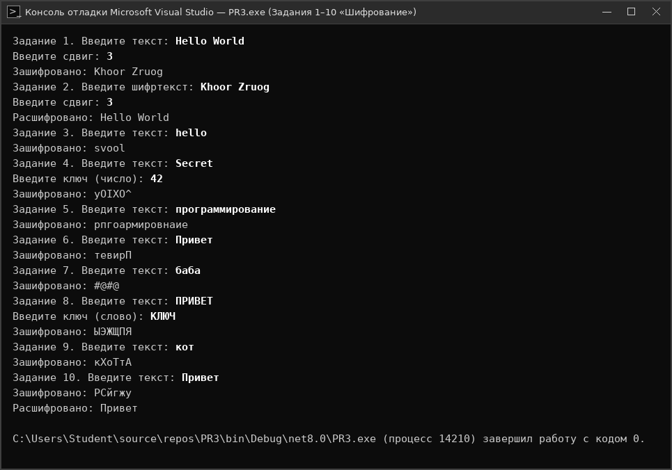

# Отчет по Практической работе №3
## Тема: «Разработка алгоритмов шифрования»

**Учебное заведение:** ГБПОУ г. Москвы «КАИТ № 20»  
**Проверил:** преподаватель Курзанов Н.В.  

---

## Лабораторный практикум
**Цель практической работы:** Познакомиться с понятием шифрование и дешифрование.  
**Задачи практической работы:** Научиться работать со строками, символами и циклами.

---

## Практическое задание

**Файл кода:** [`Практическая_работа_3.cs`](Практическая_работа_3.cs)

```csharp
using System;

class Program
{
    static void Main()
    {
        // Задание 1. Шифр Цезаря для английских букв (a-z, A-Z)
        Console.Write("Задание 1. Введите текст: ");
        string text1 = Console.ReadLine();
        Console.Write("Введите сдвиг: ");
        int shift1 = int.Parse(Console.ReadLine());
        string encrypted1 = "";
        foreach (char c in text1)
        {
            if (c >= 'a' && c <= 'z')
            {
                char newChar = (char)('a' + (c - 'a' + shift1) % 26);
                encrypted1 += newChar;
            }
            else if (c >= 'A' && c <= 'Z')
            {
                char newChar = (char)('A' + (c - 'A' + shift1) % 26);
                encrypted1 += newChar;
            }
            else
            {
                encrypted1 += c;
            }
        }
        Console.WriteLine("Зашифровано: " + encrypted1);

        // Задание 2. Расшифровка шифра Цезаря
        Console.Write("Задание 2. Введите шифртекст: ");
        string text2 = Console.ReadLine();
        Console.Write("Введите сдвиг: ");
        int shift2 = int.Parse(Console.ReadLine());
        string decrypted2 = "";
        foreach (char c in text2)
        {
            if (c >= 'a' && c <= 'z')
            {
                char newChar = (char)('a' + (c - 'a' - shift2 + 26) % 26);
                decrypted2 += newChar;
            }
            else if (c >= 'A' && c <= 'Z')
            {
                char newChar = (char)('A' + (c - 'A' - shift2 + 26) % 26);
                decrypted2 += newChar;
            }
            else
            {
                decrypted2 += c;
            }
        }
        Console.WriteLine("Расшифровано: " + decrypted2);

        // Задание 3. Шифр Атбаш
        Console.Write("Задание 3. Введите текст: ");
        string text3 = Console.ReadLine();
        string encrypted3 = "";
        foreach (char c in text3)
        {
            if (c >= 'a' && c <= 'z')
            {
                char newChar = (char)('z' - (c - 'a'));
                encrypted3 += newChar;
            }
            else if (c >= 'A' && c <= 'Z')
            {
                char newChar = (char)('Z' - (c - 'A'));
                encrypted3 += newChar;
            }
            else
            {
                encrypted3 += c;
            }
        }
        Console.WriteLine("Зашифровано: " + encrypted3);

        // Задание 4. Шифрование через XOR (^)
        Console.Write("Задание 4. Введите текст: ");
        string text4 = Console.ReadLine();
        Console.Write("Введите ключ (число): ");
        int key4 = int.Parse(Console.ReadLine());
        string encrypted4 = "";
        foreach (char c in text4)
        {
            encrypted4 += (char)(c ^ key4);
        }
        Console.WriteLine("Зашифровано: " + encrypted4);

        // Задание 5. Поменяйте местами каждые две соседние буквы
        Console.Write("Задание 5. Введите текст: ");
        string text5 = Console.ReadLine();
        string encrypted5 = "";
        for (int i = 0; i < text5.Length; i += 2)
        {
            if (i + 1 < text5.Length)
            {
                encrypted5 += text5[i + 1];
                encrypted5 += text5[i];
            }
            else
            {
                encrypted5 += text5[i];
            }
        }
        Console.WriteLine("Зашифровано: " + encrypted5);

        // Задание 6. Переверните строку задом наперёд
        Console.Write("Задание 6. Введите текст: ");
        string text6 = Console.ReadLine();
        string encrypted6 = "";
        for (int i = text6.Length - 1; i >= 0; i--)
        {
            encrypted6 += text6[i];
        }
        Console.WriteLine("Зашифровано: " + encrypted6);

        // Задание 7. Таблица замен
        Console.Write("Задание 7. Введите текст: ");
        string text7 = Console.ReadLine();
        string encrypted7 = "";
        foreach (char c in text7)
        {
            switch (c)
            {
                case 'а': encrypted7 += '@'; break;
                case 'б': encrypted7 += '#'; break;
                case 'в': encrypted7 += '$'; break;
                default: encrypted7 += c; break;
            }
        }
        Console.WriteLine("Зашифровано: " + encrypted7);

        // Задание 8. Сдвиг по ключевому слову
        Console.Write("Задание 8. Введите текст: ");
        string text8 = Console.ReadLine();
        Console.Write("Введите ключ (слово): ");
        string key8 = Console.ReadLine();
        string encrypted8 = "";
        for (int i = 0; i < text8.Length; i++)
        {
            char c = text8[i];
            int k = key8[i % key8.Length] - 'А' + 1;
            if (c >= 'А' && c <= 'Я')
            {
                encrypted8 += (char)('А' + (c - 'А' + k) % 32);
            }
            else if (c >= 'а' && c <= 'я')
            {
                encrypted8 += (char)('а' + (c - 'а' + k) % 32);
            }
            else
            {
                encrypted8 += c;
            }
        }
        Console.WriteLine("Зашифровано: " + encrypted8);

        // Задание 9. Вставка случайной буквы после каждой буквы
        Console.Write("Задание 9. Введите текст: ");
        string text9 = Console.ReadLine();
        Random rnd = new Random();
        string encrypted9 = "";
        foreach (char c in text9)
        {
            char randomLetter = (char)('А' + rnd.Next(32));
            encrypted9 += c;
            encrypted9 += randomLetter;
        }
        Console.WriteLine("Зашифровано: " + encrypted9);

        // Задание 10. Собственный шифр («+1 к ASCII»: шифрование и дешифрование)
        Console.Write("Задание 10. Введите текст: ");
        string text10 = Console.ReadLine();
        string encrypted10 = "";
        foreach (char c in text10)
        {
            encrypted10 += (char)(c + 1);
        }
        Console.WriteLine("Зашифровано: " + encrypted10);

        string decrypted10 = "";
        foreach (char c in encrypted10)
        {
            decrypted10 += (char)(c - 1);
        }
        Console.WriteLine("Расшифровано: " + decrypted10);
    }
}
```

### Скриншот работы программы:



---
## Контрольные вопросы

**1. Что такое шифрование и дешифрование?**  
Шифрование — это преобразование открытого текста в зашифрованный вид (шифртекст), чтобы его не могли прочитать посторонние. Дешифрование — обратное преобразование шифртекста в исходный открытый текст.

**2. Что такое ключ шифрования?**  
Ключ — это секретный параметр (например, число сдвига или слово), который управляет процессом шифрования и дешифрования.

**3. Как работает шифр Цезаря?**  
В шифре Цезаря каждая буква алфавита сдвигается на фиксированное число N позиций вперёд по алфавиту по кругу.

**4. Почему XOR называется симметричным шифром?**  
Потому что шифрование и дешифрование выполняются одной и той же операцией XOR (^) с одним и тем же ключом: повторное применение XOR возвращает исходный текст.

**5. Чем отличается шифр замены от шифра перестановки?**  
В шифре замены буквы заменяются другими символами по правилу или таблице, а в шифре перестановки сами буквы остаются прежними, но меняются местами.

**6. Почему простые шифры небезопасны в реальной жизни?**  
У простых шифров мало вариантов ключей, поэтому компьютер может мгновенно подобрать ключ перебором или взломать шифр по частоте встречаемости букв.

---
## Вывод
В ходе выполнения практической работы №3 в единой программе на языке C# были реализованы все 10 заданий по шифрованию и дешифрованию.
